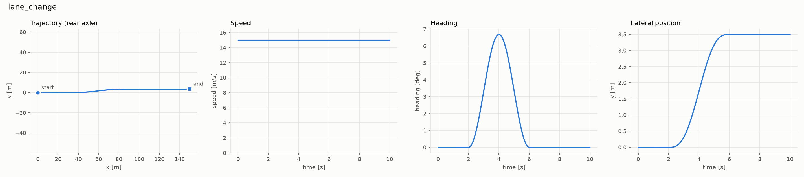
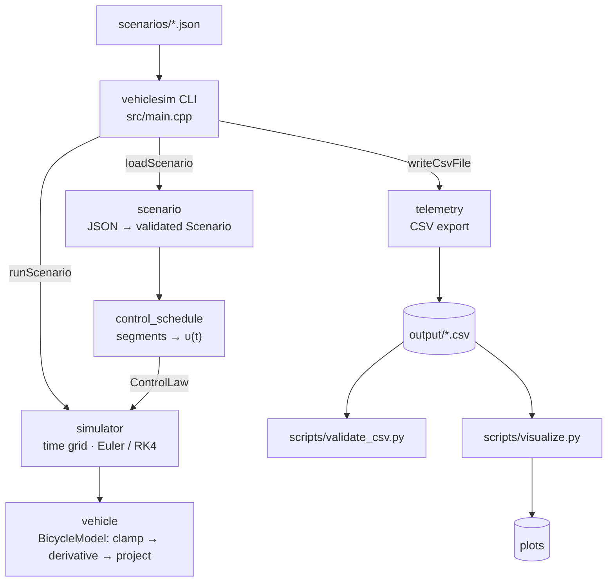
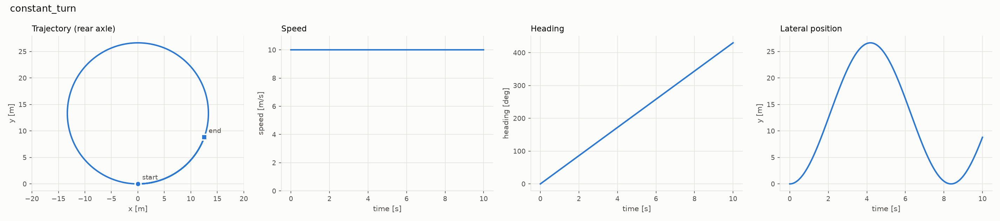
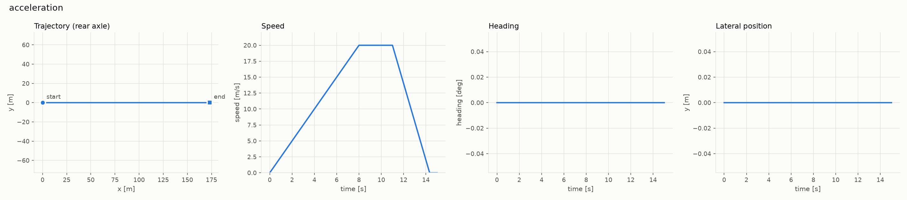
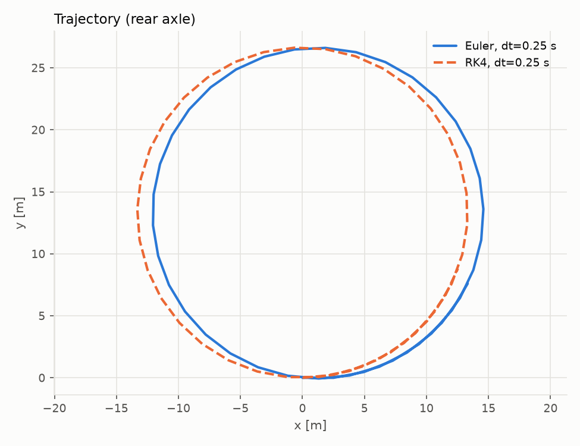

# VehicleSim

[](https://github.com/char203/vehiclesim-cpp/actions/workflows/ci.yml)

A lightweight vehicle **kinematics** simulator in C++17. It integrates a
kinematic bicycle model with a selectable integrator (Forward Euler or RK4),
runs reproducible JSON-defined driving scenarios, exports telemetry to CSV and
plots the results. Each physical claim the project makes is checked by a test
against a closed-form or high-resolution reference.

> **Scope.** This is a *kinematic* model: it describes the geometry of motion
> under rolling-without-slip assumptions. It is **not** a high-fidelity vehicle
> dynamics simulator and has **not** undergone automotive-grade validation of
> any kind. See [Limitations](#limitations).

<p align="center"></p>

## Contents

- [Overview](#overview)
- [Architecture](#architecture)
- [Mathematical model](#mathematical-model)
- [Installation](#installation)
- [Build](#build)
- [Usage](#usage)
- [Scenarios](#scenarios)
- [Sample plots](#sample-plots)
- [Testing](#testing)
- [Docker](#docker)
- [Continuous integration](#continuous-integration)
- [Design decisions](#design-decisions)
- [Limitations](#limitations)
- [Future improvements](#future-improvements)
- [Project structure](#project-structure)

## Overview

| Capability | Implementation |
|---|---|
| Vehicle model | Kinematic bicycle, rear-axle reference, SI units |
| Integrators | Forward Euler (order 1), classical RK4 (order 4), selectable per scenario or on the command line |
| Constraints | Steering and acceleration clamping, top-speed saturation, no reverse motion |
| Scenarios | JSON files with strict schema validation and located error messages |
| Output | CSV `time,x,y,heading,speed,steering,acceleration`; drift-free timestamps that end exactly at the duration |
| Visualization | Python/matplotlib: trajectory (equal axes), speed, heading, lateral position |
| Testing | 7 C++ unit suites (91 cases) + 19 end-to-end CTest entries; ASan/UBSan |
| Reproducibility | Deterministic runs, pinned dependency hashes, digest-pinned Docker image, CI on Linux and macOS |

## Architecture



Dependencies only point downward. The physics layer (`vehicle`) knows nothing
about time stepping, and the simulator knows nothing about JSON or CSV. All
code except `main.cpp` is compiled into the static library `vehiclesim_core`,
which both the CLI and the tests link against. Details:
[docs/architecture.md](docs/architecture.md).

## Mathematical model

Rear-axle kinematic bicycle model with wheelbase `L`:

```
dx/dt = v · cos θ          θ  heading (rad, CCW from +x, unwrapped)
dy/dt = v · sin θ          δ  front steering angle (rad, + = left)
dθ/dt = v · tan δ / L      a  longitudinal acceleration (m/s²)
dv/dt = a
```

With constant `v` and `δ`, the rear axle follows a circle of radius
`R = L / tan δ`. The tests use this closed-form solution as their main
reference.

**Constraint handling**, in three explicit stages:

1. **Actuator clamping:** `|δ| ≤ δ_max`, `−b_max ≤ a ≤ a_max`. The clamped
   command is what gets integrated *and* what gets logged.
2. **Speed saturation in the dynamics:** acceleration is zeroed when it would
   push `v` above `v_max` or below 0. A stopped vehicle that keeps braking
   therefore stays stopped, instead of integrating to negative speed and
   driving backwards.
3. **Post-step projection:** `v ← clamp(v, 0, v_max)` after each step removes
   any overshoot within a step.

**Integration.** The control is sampled at the start of each step and held
constant across it (zero-order hold, like a digital controller). Measured
convergence orders against the analytical circle are **1.000** for Euler and
**4.000** for RK4.

**Time grid.** `t_k = k · dt` is computed from the integer step index, never
by repeated addition, so timestamps do not drift. The last sample is exactly
`duration`; if `duration / dt` is not an integer, the final step is
shortened.

Full derivation, constraint rationale and error analysis:
[docs/mathematics.md](docs/mathematics.md).

## Installation

Requirements:

| Tool | Requirement | Verified with | Used for |
|---|---|---|---|
| C++17 compiler | C++17 including `<filesystem>` | Apple Clang 17, GCC 13.3 | simulator and tests |
| CMake | ≥ 3.16 (declared minimum) | 3.28.3, 4.4.4 | build and CTest |
| Python | 3.x stdlib for `validate_csv.py`; ≥ 3.11 for plots | 3.11.8, 3.12 | CSV validation and plots |
| matplotlib | 3.11.2 (pinned in `scripts/requirements.txt`) | 3.11.2 | plots only |
| Docker | optional | Docker 24.0.5 | containerized build and tests |

Older compilers and CMake versions may work but have not been tested.

The only C++ dependency, [nlohmann/json](https://github.com/nlohmann/json)
3.12.0, is taken from the system if CMake can find it. Otherwise CMake
downloads the release archive and verifies its SHA-256 hash.

```bash
git clone https://github.com/char203/vehiclesim-cpp.git
cd vehiclesim-cpp
python3 -m venv .venv
.venv/bin/pip install -r scripts/requirements.txt
```

## Build

```bash
cmake -S . -B build
cmake --build build
ctest --test-dir build --output-on-failure
```

The default build type is Release. Other configurations:

```bash
cmake -S . -B build-debug -DCMAKE_BUILD_TYPE=Debug
cmake -S . -B build-strict -DVEHICLESIM_WARNINGS_AS_ERRORS=ON
cmake -S . -B build-asan -DCMAKE_BUILD_TYPE=Debug -DVEHICLESIM_ENABLE_SANITIZERS=ON
```

Warnings (`-Wall -Wextra -Wpedantic -Wshadow -Wconversion -Wsign-conversion
-Wold-style-cast …`) are applied per target, so third-party code is not
affected. The project builds cleanly with Apple Clang 17 and GCC 13.

## Usage

```bash
# Run a scenario and print a summary
./build/vehiclesim scenarios/constant_turn.json

# Write telemetry to CSV
./build/vehiclesim scenarios/lane_change.json -o output/lane_change.csv

# Override the integrator or time step
./build/vehiclesim scenarios/constant_turn.json --integrator euler --dt 0.25 -o output/turn_euler.csv

# Everything at once: build, run all scenarios, validate CSVs, render all plots
scripts/run_all.sh
```

Example output:

```text
scenario    : constant_turn
description : Constant 10 m/s with a fixed 0.2 rad left steer: a circle of radius L/tan(0.2) = 13.32 m, completing one lap in 8.37 s.
integrator  : rk4  dt=0.0100 s  duration=10.0000 s  samples=1001
final state : t=10.0000 s  x=12.5292 m  y=8.7998 m  heading=7.5078 rad (430.1641 deg)  speed=10.0000 m/s
```

Errors name their location and set the exit code (0 success, 1 scenario or
simulation error, 2 usage error). Real output for the invalid inputs in
`tests/data/`, plus a misspelled key:

```text
error: tests/data/invalid_wheelbase.json: vehicle: wheelbase must be > 0 (got -2.7)
error: tests/data/malformed.json: malformed JSON: [json.exception.parse_error.101] parse error at line 1, column 52: syntax error while parsing object key - unexpected '}'; expected string literal
error: typo.json: simulation.time_stp: unknown key (allowed: duration, time_step, integrator)
```

Plot individual CSVs, or overlay up to three runs:

```bash
.venv/bin/python scripts/visualize.py output/lane_change.csv -o output/plots
.venv/bin/python scripts/visualize.py --overlay --label Euler --label RK4 a.csv b.csv -o output/plots
```

### CSV format

| column | unit | meaning |
|---|---|---|
| `time` | s | sample time; the first row is `0`, the last is exactly the duration |
| `x`, `y` | m | rear-axle position |
| `heading` | rad | unwrapped yaw angle |
| `speed` | m/s | longitudinal speed, within `[0, max_speed]` |
| `steering` | rad | clamped steering command applied from this row onward |
| `acceleration` | m/s² | clamped acceleration command applied from this row onward |

Values are written with 12 significant digits, independent of locale, with
`\n` line endings. The final row repeats the command held over the last step.

## Scenarios

| File | What it shows | Key result (RK4, dt = 0.01 s) | Closed-form check |
|---|---|---|---|
| [`acceleration.json`](scenarios/acceleration.json) | 2.5 m/s² launch from rest to the 20 m/s cap (saturates at 8 s), 1 s coast, full braking (6 m/s²) to a stop | x = 173.3334 m, v = 0 | 80 + 60 + 33.33 = 173.333 m |
| [`constant_turn.json`](scenarios/constant_turn.json) | 10 m/s, constant 0.2 rad steer for 10 s | heading 7.5078 rad; every point on R = 13.3195 m | θ = v t / R = 7.5078 rad |
| [`lane_change.json`](scenarios/lane_change.json) | 15 m/s; one 4 s period of sine steering (A = 0.0165 rad) between t = 2 s and 6 s | lateral offset 3.4966 m, final heading 0 | v²AT²/(2πL) = 3.501 m (small angle) |

Scenario schema (units SI, angles in radians; unknown keys are rejected):

```json
{
  "name": "lane_change",
  "description": "optional free text",
  "vehicle": { "wheelbase": 2.7, "max_steering_angle": 0.6, "max_acceleration": 3.0,
               "max_braking": 6.0, "max_speed": 30.0 },
  "initial_state": { "x": 0.0, "y": 0.0, "heading": 0.0, "speed": 15.0 },
  "simulation": { "duration": 10.0, "time_step": 0.01, "integrator": "rk4" },
  "controls": [
    { "start": 2.0, "end": 6.0, "acceleration": 0.0,
      "steering": { "profile": "sine", "amplitude": 0.0165, "period": 4.0 } }
  ]
}
```

`controls` are sorted, non-overlapping `[start, end)` segments. `steering`
is either a number (constant) or a sine profile. Outside every segment the
vehicle coasts straight ahead. Commands beyond the vehicle limits are
accepted, then clamped, and the CLI prints a warning.

## Sample plots

All plots below were generated by `scripts/run_all.sh` from the shipped
scenarios. Trajectories use equal axis scaling.

**Constant turn.** A closed circle of radius 13.32 m; heading grows linearly.


**Straight-line acceleration.** Speed saturates at 20 m/s, then braking
stops the vehicle at 14.34 s (exact: 14.333 s) and it stays stopped.


**Euler vs RK4 at a deliberately coarse dt = 0.25 s.** After 10 s, Euler's
position error is 1.44 m and RK4's is 6.6e-6 m.

<p align="center"></p>

## Testing

```bash
ctest --test-dir build --output-on-failure
```

26 CTest entries:

- **7 unit suites (91 cases)** — validation, model equations, integrators,
  simulation loop, scenarios, CSV, analytical trajectories
- **4 scenario runs** — each scenario is run twice through the CLI and the
  CSVs must be byte-identical
- **4 CSV validations** — `validate_csv.py` checks header, timestamps,
  initial state and limits against the scenario
- **11 CLI tests** — exit codes and error messages for malformed or invalid
  input

Highlights:

| Property | How it is tested |
|---|---|
| Straight line with zero steering | cross-track deviation < 1e-11 m over 10 s |
| Constant speed with zero acceleration | speed exactly equal at every sample |
| Heading change and turning radius | Δθ = v tan δ T / L to 1e-12; every point on R = L/tan δ to 1e-9 m |
| Euler/RK4 convergence | observed order measured over three dt halvings: 1.000 and 4.000 |
| Speed bounds | never above `max_speed`, never negative, including steps that cross a limit mid-step |
| Invalid input | wheelbase, steering limit, speed, time step, integrator, segments, malformed JSON |
| Timestamps | exact strings, exact final time, no drift over 10⁶ steps |
| Determinism | bitwise comparison of in-memory runs and CSV files |

Tests were also checked for their ability to fail: disabling speed saturation
breaks 9 tests, and removing the segment-boundary tolerance breaks 2.
Methodology, tolerances and their justification:
[docs/validation.md](docs/validation.md).

## Docker

The `Dockerfile` provides a reproducible Ubuntu 24.04 build (base image pinned
by digest, GCC 13, warnings as errors) with three stages:

```bash
# Run the full test suite in a clean Linux environment
docker build --target test -t vehiclesim-test .
docker run --rm vehiclesim-test

# Build the minimal runtime image and run a scenario
docker build -t vehiclesim .
docker run --rm vehiclesim scenarios/lane_change.json

# Write telemetry to the host
mkdir -p output
docker run --rm -v "$PWD/output:/output" vehiclesim scenarios/lane_change.json -o /output/lane_change.csv
```

The runtime image (about 100 MB) runs as an unprivileged user (uid 10001). On
Linux hosts, add `--user "$(id -u):$(id -g)"` if that user cannot write to the
mounted directory.

## Continuous integration

[`.github/workflows/ci.yml`](.github/workflows/ci.yml) runs on every push and
pull request:

- **Matrix** `{ubuntu-latest, macos-latest} × {Debug, Release}`, all with
  `-Werror`; ASan + UBSan on Linux Debug.
- Configure → build → all 26 CTest entries → `scripts/run_all.sh` (runs the
  three scenarios, validates every CSV, renders all plots) → check that every
  expected CSV/PNG exists → upload them as build artifacts.
- **Docker job:** builds the test image and runs the suite in the container,
  then builds the runtime image and validates a CSV written to a bind mount.
- **Caching:** pip packages, the FetchContent download, and Docker layers (GHA
  cache).

Any failing test, scenario, validation or missing plot fails the workflow.

## Design decisions

- **Value types, RAII, no inheritance.** `BicycleModel`, `Simulator`,
  `ControlSchedule` and `Scenario` are immutable values that validate in
  their constructors; they cannot exist in an invalid state. Two integrators
  are an `enum class` and a `switch`, not a class hierarchy.
- **Explicit, located errors.** Exceptions carry the field path and the
  offending value. The CLI maps them to distinct exit codes.
- **Strict JSON.** Unknown keys are errors, so typos cannot silently fall back
  to defaults.
- **Zero-order-hold control.** This matches a sampled controller and keeps
  the logged command identical to the integrated one. Its accuracy cost for
  time-varying commands (first order) is measured and documented, not hidden.
- **Drift-free time.** Timestamps come from the integer step index, and the
  final sample lands exactly on the duration.
- **Locale-independent CSV.** A classic-locale stream, so a system set to a
  decimal-comma locale cannot corrupt output.
- **Minimal dependencies.** One header-only JSON library, hash-pinned and
  kept private to one source file. The test harness is about 100 lines,
  in-house, with no global registration.
- **SI units documented on every field**, instead of a units library, which
  would be overengineering at this scale.

More in [docs/architecture.md](docs/architecture.md).

## Limitations

This is a **kinematic** model, intended for education, motion-planning
prototypes and low-speed manoeuvres. It assumes the wheels roll without
slipping and the vehicle responds instantly to commands. In particular, there
is:

- **No tire slip.** Lateral tyre forces and slip angles are not modelled, so
  results become unrealistic at high lateral acceleration (roughly above
  0.3–0.5 g), where a real vehicle under- or oversteers.
- **No suspension**: no roll, pitch or heave.
- **No collision detection**: the vehicle moves through empty space.
- **No road friction model**: no µ-limit, no drag or rolling resistance.
  Coasting keeps the speed constant, and braking is never friction-limited.
- **No dynamic load transfer** between axles or sides.
- **No actuator dynamics**: steering angle and acceleration change instantly.
  There are no rate limits and no powertrain or brake models.
- **Forward motion only**: speed is clamped to `[0, v_max]`; reversing is not
  modelled.
- **Sampled control**: commands are held over each step, so continuously
  varying commands are first-order accurate in `dt`, whatever the integrator.
- **Flat 2-D world**: no elevation, banking or grade.
- **Reproducibility scope**: bitwise identical on a given platform and
  toolchain; across macOS/clang and Linux/GCC, results agree to ~1e-16 (math
  library and FMA differences).

Nothing here constitutes automotive-grade verification or validation
(e.g. ISO 26262 or SOTIF). The tests show that the code solves the stated
equations correctly; they do not show that the equations describe a real
vehicle.

## Future improvements

- Dynamic bicycle model with a linear or Pacejka tyre model, to compare
  against the kinematic model at higher lateral acceleration
- Steering-rate and jerk limits (first-order actuator lag)
- Adaptive step size (e.g. RK45 / Dormand–Prince) with error control
- Control evaluated at RK4 stage times, as an option for continuous-time
  commands
- Closed-loop controllers (pure pursuit, Stanley) following a reference path
- More steering profiles (ramp, piecewise-linear keyframes) and JSON Schema
  publication for editor validation
- Python bindings (pybind11) for notebook-driven experiments

## Project structure

```
vehiclesim-cpp/
├── CMakeLists.txt              build definition, options, dependency pin
├── Dockerfile, .dockerignore   build / test / runtime images
├── .github/workflows/ci.yml    CI matrix + Docker job
├── cmake/                      warning policy, CTest driver scripts
├── include/                    vehicle, simulator, control_schedule, scenario, telemetry
├── src/                        implementations + main.cpp (CLI)
├── scenarios/                  acceleration, constant_turn, lane_change
├── tests/                      7 unit suites, test harness, invalid-input fixtures
├── scripts/                    run_all.sh, visualize.py, validate_csv.py, requirements.txt
├── docs/                       architecture.md, mathematics.md, validation.md, images/
└── DEVELOPMENT_LOG.md          milestone-by-milestone record of what was run
```

## License

MIT — see [LICENSE](LICENSE).
